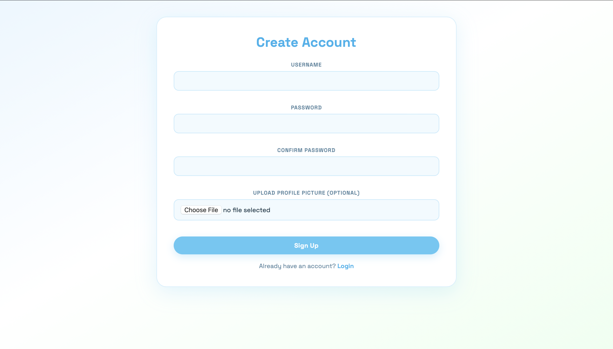
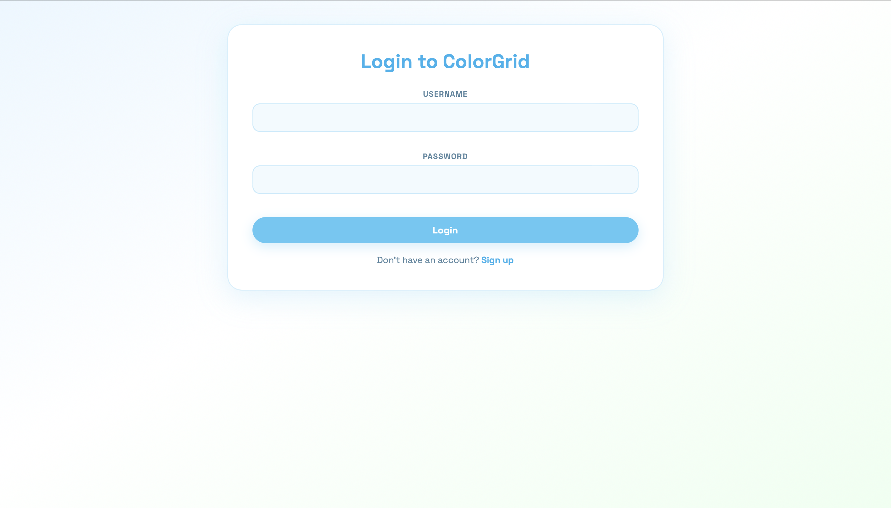
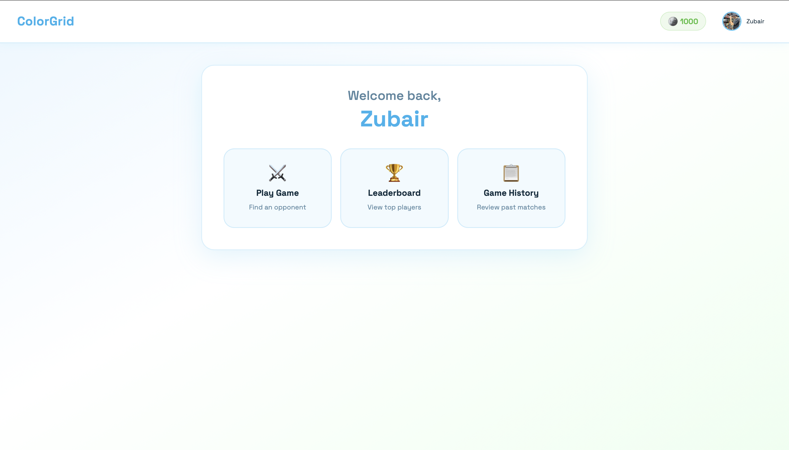
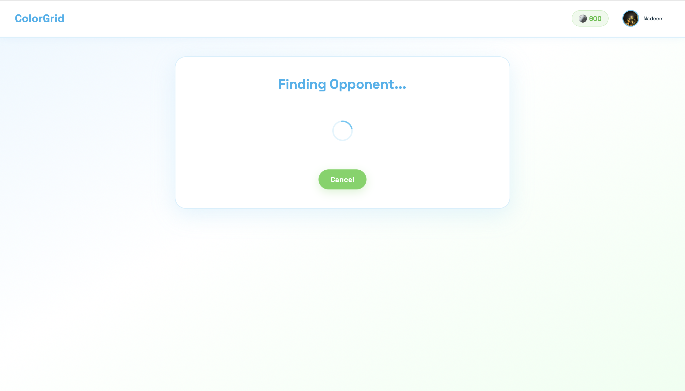
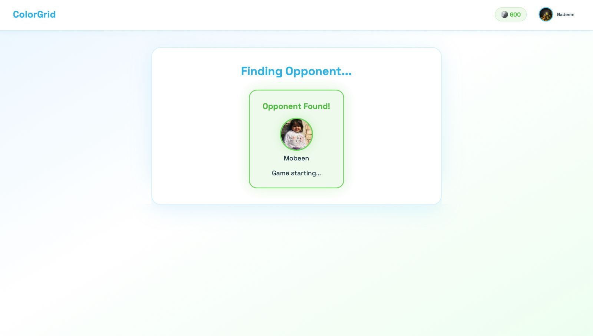
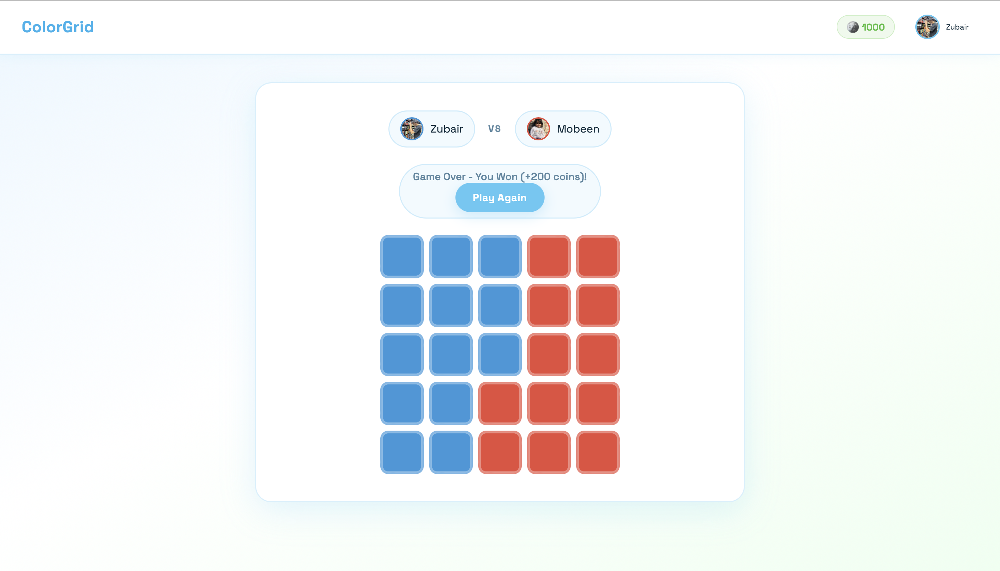
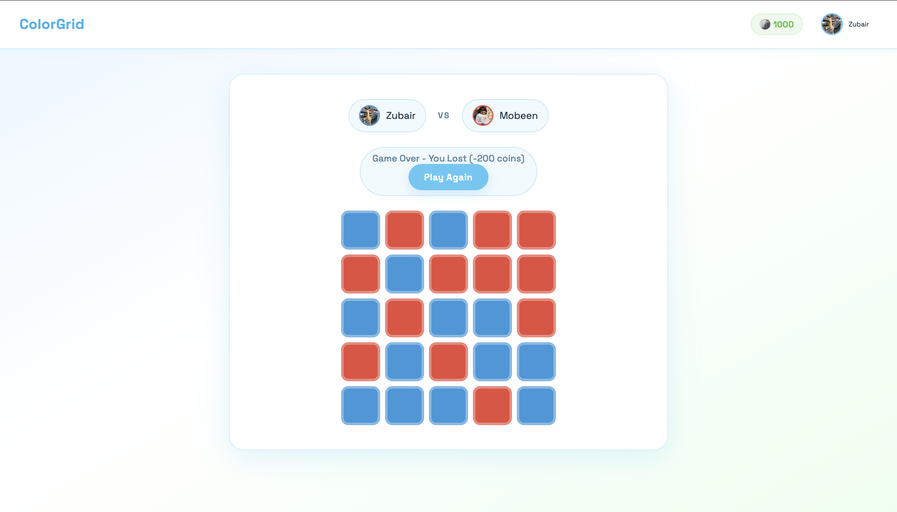
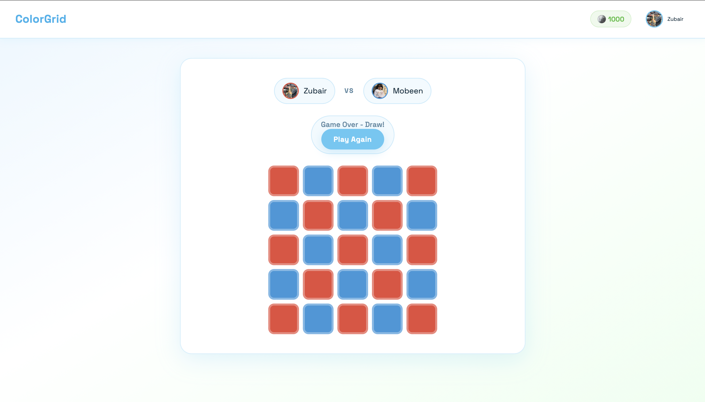
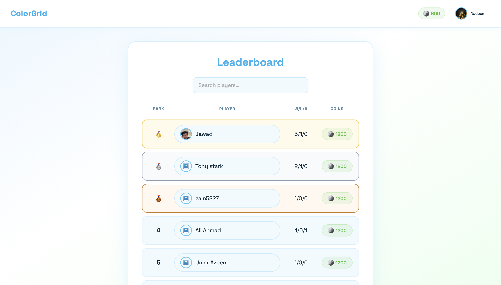
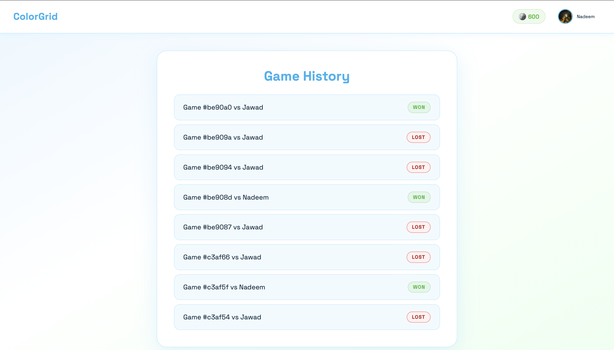

# ColorGrid


> A real-time, turn-based 2-player color conquest game built with React, Node.js, Express, MongoDB, and Socket.io. Compete against real-time opponents to build the largest connected island of your color on a 5x5 grid!

---

## Table of Contents

- [About the Project](#about-the-project)
- [Visual Showcase (Screenshots 1-10)](#visual-showcase-screenshots-1-10)
- [Core Features](#core-features)
- [Game Logic & Rules](#game-logic--rules)
- [Tech Stack & Architecture](#tech-stack--architecture)
- [Installation & Local Setup](#installation--local-setup)
- [Environment Configuration](#environment-configuration)
- [Database Schemas](#database-schemas)
- [Socket.io Architecture & Events](#socketio-architecture--events)
- [API Endpoints Reference](#api-endpoints-reference)
- [Performance & Security Enhancements](#performance--security-enhancements)
- [License & Acknowledgments](#license--acknowledgments)

---

## About the Project

**ColorGrid** is a competitive, real-time turn-based multiplayer web game inspired by tactical grid mechanics. Two players are matched randomly, assigned distinct colors, and placed on a 5x5 grid. On each turn, a player claims an empty cell with their color. 

When all 25 cells are occupied, the game evaluates both grids using a 4-directional Flood Fill algorithm to determine the size of each player's largest connected block (**Island**). The player with the largest connected island wins the match, earning 200 coins, while the loser forfeits 200 coins.

The project features a persistent persistent navigation system, client-side image compression, rate-limited auth endpoints, indexed MongoDB aggregations, and socket reconnection resilience.

---

## Visual Showcase (Screenshots 1-10)

Here is the complete step-by-step walkthrough of ColorGrid in sequential order:

### 1. Landing & Welcome Screen (`/`)
The entry point of ColorGrid inviting players to log in or create a new account.


### 2. User Authentication (`/login` & `/signup`)
Secure authentication interface allowing user signup (starting with 1000 coins) and login.


### 3. Player Dashboard (`/home`)
Central hub featuring navigation to Play, Leaderboard, and Game History.


### 4. Matchmaking Queue (`/newgame/waiting`)
Real-time matchmaking system with an instant cancel button before opponents are matched.


### 5. Real-Time Gameplay (`/newgame/:game_id`)
The 5x5 grid with player header info, real-time turn indicator, and active color placements.


### 6. Game End & Winner Evaluation
Automatic island size calculation announcing the winner, coin reward (+200 / -200), and a Play Again button.


### 7. Match History List (`/history`)
Comprehensive match records listing past opponents, game IDs, and match outcomes.


### 8. Match Snapshot Viewer (`/history/:game_id`)
Snapshot page allowing players to inspect the final 5x5 grid configuration of any past game.


### 9. Global Leaderboard (`/leaderboard`)
Live player rankings sorted by coin balance with real-time player search and W/L/D stats.


### 10. User Profile Customization (`/update-profile`)
Profile management interface for updating display name, password, and compressed avatar URL.


---

## Core Features

- **Real-Time Socket Gameplay:** Instant turn synchronization and move broadcasting powered by Socket.io without any page reloads.
- **Island Conquest Logic:** Evaluates 4-directional connected cells (vertical/horizontal) using recursive DFS flood fill.
- **Reconnection & Grace Period:** 10-second disconnection buffer allowing players to refresh or reconnect without forfeiting active matches.
- **Economy System:** Starting balance of 1000 coins per user, with +200 coins awarded for victories and -200 deducted for losses (down to 0 min).
- **Optimized Leaderboard:** Indexed MongoDB query with cached user stat tracking delivering sub-10ms leaderboard load times.
- **Client-Side Avatar Compression:** Automatic HTML5 Canvas image compression for profile pictures before upload.
- **Rate-Limited Authentication:** Express rate-limiters protecting signup and login endpoints against brute-force attacks.

---

## Game Logic & Rules

1. **Match Initialization:**
   - Players emit `find_match` to join the waiting room.
   - The server matches two waiting players randomly and creates a room `game_<game_id>`.
   - Players are randomly assigned distinct colors (e.g., Red vs Blue).
2. **Turn-Based Placement:**
   - Players take turns selecting unassigned grid cells on the 5x5 board.
   - Each move is validated on the server and broadcast via `move_made`.
3. **Forfeit Mechanics:**
   - Clicking **Forfeit** immediately awards victory to the opponent by default.
4. **Winner Determination:**
   - When all 25 cells are claimed, the server executes `maxAreaOfIsland()` for both colors.
   - The player with the larger single connected block (connected horizontally or vertically) wins.
   - Equal maximum island sizes result in a **Draw**.

---

## Tech Stack & Architecture

- **Frontend:** React (TypeScript), Vite, React Router v6, Axios, Socket.io-Client, Vanilla CSS (Design Tokens & Glassmorphism)
- **Backend:** Node.js, Express.js, Socket.io, MongoDB, Mongoose ODM, BcryptJS, JSON Web Tokens (JWT)
- **Database:** MongoDB Atlas (Indexed collections for Users and Games)

```
ColorGrid/
├── client/                 # React Frontend (Vite + TS)
│   ├── src/
│   │   ├── components/     # Navbar, ProtectedRoute, UI components
│   │   ├── context/        # AuthContext (JWT session management)
│   │   ├── pages/          # Home, Game, Leaderboard, History, Profile
│   │   ├── types/          # Shared TypeScript interfaces
│   │   ├── utils/          # Client-side canvas image compression
│   │   └── lib/            # Axios API & Socket connection helpers
│   └── public/
├── server/                 # Express + Socket.io Server
│   ├── controllers/        # Auth, Game History, Leaderboard APIs
│   ├── middleware/         # JWT Authentication & Rate limiting
│   ├── models/             # Mongoose User & Game Schemas
│   ├── routes/             # RESTful API route definitions
│   ├── sockets/            # Real-time room management & match state
│   └── utils/              # Island calculation algorithm (DFS)
└── screenshots/            # Sequenced application screenshots (1-10)
```

---

## Installation & Local Setup

### Prerequisites
- **Node.js**: v18.x or higher
- **npm**: v9.x or higher
- **MongoDB**: Local MongoDB instance (`mongodb://127.0.0.1:27017`) or MongoDB Atlas connection string.

### Step 1: Clone the Repository
```bash
git clone https://github.com/shortcut-jawad/ColorGrid.git
cd ColorGrid
```

### Step 2: Install Server Dependencies
```bash
cd server
npm install
```

### Step 3: Install Client Dependencies
```bash
cd ../client
npm install
```

### Step 4: Run the Development Server
In terminal 1 (Server):
```bash
cd server
npm run dev
```

In terminal 2 (Client):
```bash
cd client
npm run dev
```

Open your browser at `http://localhost:5173` to play!

---

## Environment Configuration

Create a `.env` file in the `server/` directory:

```env
PORT=8000
MONGO_URI=mongodb://127.0.0.1:27017/colorgrid
JWT_SECRET=your_jwt_secret_key_here
```

Create a `.env` file in the `client/` directory (optional):

```env
VITE_API_URL=http://localhost:8000
```

---

## Database Schemas

### User Schema (`User`)
```typescript
{
  _id: ObjectId,
  username: { type: String, required: true, unique: true },
  password: { type: String, required: true },
  profile_picture_url: { type: String, default: "" },
  coins: { type: Number, default: 1000 },
  wins: { type: Number, default: 0 },
  losses: { type: Number, default: 0 },
  draws: { type: Number, default: 0 }
}
```

### Game Schema (`Game`)
```typescript
{
  _id: ObjectId,
  player1_id: { type: ObjectId, ref: "User", required: true },
  player2_id: { type: ObjectId, ref: "User", required: true },
  player1_color: { type: String, required: true },
  player2_color: { type: String, required: true },
  final_grid: [[String]],
  result: { type: String, enum: ["player1", "player2", "draw"], required: true },
  winner_id: { type: ObjectId, ref: "User", default: null },
  created_at: { type: Date, default: Date.now }
}
```

---

## Socket.io Architecture & Events

| Event Name | Direction | Payload | Description |
| :--- | :--- | :--- | :--- |
| `find_match` | Client ➔ Server | `{ userId }` | Places player into the matchmaking queue |
| `cancel_match` | Client ➔ Server | `{ userId }` | Removes player from waiting queue before match starts |
| `start_game` | Server ➔ Client | `{ gameId, gameState }` | Broadcasts game initialization and assigned colors |
| `make_move` | Client ➔ Server | `{ gameId, row, col }` | Emits cell selection on player's turn |
| `move_made` | Server ➔ Client | `{ gameState }` | Broadcasts updated 5x5 grid state to both room sockets |
| `forfeit_game` | Client ➔ Server | `{ gameId }` | Triggers immediate victory for remaining player |
| `game_end` | Server ➔ Client | `{ winnerId, isDraw, result }` | Emits final result and coin balance updates |

---

## API Endpoints Reference

### Authentication Routes (`/api/auth`)
- `POST /api/auth/signup` - Register a new account (Rate Limited)
- `POST /api/auth/login` - Authenticate user credentials (Rate Limited)
- `GET /api/auth/me` - Fetch authenticated user session info
- `PUT /api/auth/update` - Update profile picture, username, or password

### Leaderboard Routes (`/api/leaderboard`)
- `GET /api/leaderboard` - Fetch top 100 players sorted by coins with W/L/D stats

### Game History Routes (`/api/games`)
- `GET /api/games/history` - Fetch match history for authenticated user
- `GET /api/games/history/:id` - Fetch final grid snapshot of a specific past game

---

## Performance & Security Enhancements

1. **IPv4 Host Binding:** Bound local MongoDB connections to `127.0.0.1` to bypass Node.js 18+ dual-stack IPv6 DNS resolution delays.
2. **Payload Compression:** Client-side HTML5 canvas compression caps profile picture payloads under 500KB before transmission.
3. **Database Indexing:** Compound indexes on `coins`, `player1_id`, `player2_id`, and `created_at` ensure sub-10ms response times on history and leaderboard endpoints.
4. **Brute Force Protection:** Express rate limiters protect authentication endpoints against credential stuffing attacks.

---

## License & Acknowledgments

Distributed under the **MIT License**. See [`LICENSE`](./LICENSE) for details.

Developed as part of the **Advanced Programming (Spring 2025)** curriculum using MERN & Socket.io architecture.
